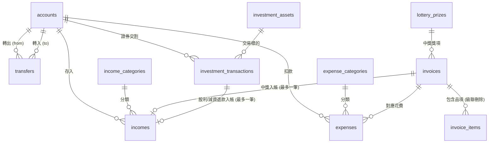

# 個人記帳本資料庫設計規格書（Supabase PostgreSQL）

本文件為個人記帳系統（基於 Supabase PostgreSQL）之關聯式資料庫結構設計規格書。本設計專注於金流軌跡的真實性與嚴謹性，採用單式記帳體系，涵蓋「入帳」、「花費」、「投資」、「發票」四大冊子與「帳戶」金流載體。

---

## 一、設計準則與整體架構約定

1. **主鍵設計（Primary Key）**：
   - 所有資料表統一使用 `BIGINT GENERATED ALWAYS AS IDENTITY PRIMARY KEY`。
   - 主鍵由資料庫底層自動生成，一旦建立後嚴禁修改。
2. **時間戳記（Timestamps）**：
   - 每一張表皆包含 `created_at` 與 `updated_at` 兩個 `timestamptz` 欄位。
   - `created_at`：由資料庫在插入（INSERT）時以 UTC 自動填入，預設值為 `timezone('utc', now())`。
   - `updated_at`：資料更新時由後端應用程式（API）明確寫入當前 UTC 時間，不依賴可能被略過的 client 行為。
3. **參照完整性與刪除限制（Foreign Key Constraints）**：
   - 所有外鍵參照皆預設為 **`ON DELETE RESTRICT`**（父列仍被子列參照時，嚴禁刪除父列）。
   - 全資料庫**僅有唯一一種例外**：發票品項跟著發票一起消失，即 `invoice_items.invoice_id` 設定為 **`ON DELETE CASCADE`**。
4. **金額、匯率與幣別規範**：
   - 金額數值一律採用具小數精度的 `NUMERIC(14, 4)`，避免浮點數誤差。
   - 幣別採用標準三碼大寫英文 `CHAR(3)`（如 `TWD`, `USD`, `JPY`）。
   - 外幣交易每筆皆留存兌換新台幣之匯率 `exchange_rate`（`NUMERIC(12, 6)`）。
   - 約束規則：新台幣 `TWD` 匯率必須恆為 `1`，非新台幣之匯率必須大於 `0`。
5. **餘額與持股衍生性**：
   - 帳戶餘額、投資持股數與平均持有成本**不儲存於任何可修改的實體欄位中**，全數由明細交易動態彙總計算，確保無資料不一致之髒讀風險。
6. **商業規則落實層級**：
   - 凡可在 PostgreSQL 單列或靜態資料表達者，一律以資料庫約束（`NOT NULL`, `CHECK`, `UNIQUE`, `FOREIGN KEY`）強制保證。
   - 凡涉及跨列彙總、交易時間序列驗證（如持股不可為負）者，一律標註為 **【由 API 在寫入前檢查】**，並於 API 交易中使用行級悲觀鎖（`SELECT ... FOR UPDATE`）確保並行安全。

---

## 二、實體關聯架構圖 (ERD)

---

## 三、資料表詳細規格

### 1. `accounts`（帳戶表）

- **在記什麼**：個人所屬之所有資金載體實體或虛擬帳戶，包含現金皮夾、銀行活期帳戶、信用卡、以及券商證券交割戶。
- **為什麼單獨成表**：帳戶是所有金流（入帳、花費、帳戶移轉、投資結算）的最終歸宿與實體載體。單獨成表能統一管理不同貨幣、不同帳戶形態，並提供嚴格的參照完整性，避免帳戶名稱游離失控。
- **欄位列表**：

| 欄位名稱 | 型別 | 必填 / 可空 | 唯一性 | 預設值 | 說明 |
| :--- | :--- | :--- | :--- | :--- | :--- |
| `id` | `BIGINT` | 必填 | PRIMARY KEY | 自動產生 | 主鍵，不可變更之整數 |
| `name` | `VARCHAR(50)` | 必填 | UNIQUE | 無 | 帳戶名稱（例：台新 Richart 活存、國泰世華信用卡、現金皮夾） |
| `account_type` | `VARCHAR(30)` | 必填 | 否 | 無 | 帳戶類型：`cash`、`bank`、`credit_card`、`securities_settlement` |
| `currency` | `CHAR(3)` | 必填 | 否 | `'TWD'` | 帳戶幣別（ISO 4217 三碼大寫英文） |
| `is_active` | `BOOLEAN` | 必填 | 否 | `true` | 是否啟用中（停用後不可記帳） |
| `note` | `TEXT` | 可空 | 否 | `NULL` | 帳戶備註說明 |
| `created_at` | `TIMESTAMPTZ` | 必填 | 否 | `timezone('utc', now())` | 資料庫建立時間（UTC） |
| `updated_at` | `TIMESTAMPTZ` | 必填 | 否 | 無 | 應用程式更新時間（UTC） |

- **約束條件**：
  - `CHECK (account_type IN ('cash', 'bank', 'credit_card', 'securities_settlement'))`：限定四種合法帳戶種類。
  - `CHECK (currency ~ '^[A-Z]{3}$')`：幣別必須為三碼大寫英文。
- **外鍵參照行為**：
  - 本表為核心實體。被 `transfers`、`incomes`、`expenses`、`investment_transactions` 參照時，**嚴禁刪除**（`ON DELETE RESTRICT`）。

---

### 2. `transfers`（帳戶移轉表）

- **在記什麼**：資金自甲帳戶移動至乙帳戶之紀錄，例如自銀行領出新台幣放進皮夾、由銀行轉帳繳納信用卡費、銀行存入證券交割戶、或台幣活存結匯至美金外幣帳戶。
- **為什麼單獨成表**：移轉屬於資產內部重分配，**不是入帳，也不是花費**。若將移轉混用入帳或花費記錄，將導致個人總收入與總支出嚴重虛增。單獨成表並明確設定來源與目的帳戶，能保持收支報表乾淨且能精確重構雙方帳戶餘額。
- **欄位列表**：

| 欄位名稱 | 型別 | 必填 / 可空 | 唯一性 | 預設值 | 說明 |
| :--- | :--- | :--- | :--- | :--- | :--- |
| `id` | `BIGINT` | 必填 | PRIMARY KEY | 自動產生 | 主鍵，不可變更之整數 |
| `from_account_id` | `BIGINT` | 必填 | 否 | 無 | 轉出帳戶，外鍵指向 `accounts.id` |
| `to_account_id` | `BIGINT` | 必填 | 否 | 無 | 轉入帳戶，外鍵指向 `accounts.id` |
| `from_amount` | `NUMERIC(14, 4)` | 必填 | 否 | 無 | 轉出金額（扣減來源帳戶之金額） |
| `to_amount` | `NUMERIC(14, 4)` | 必填 | 否 | 無 | 轉入金額（增加目的帳戶之金額，支援匯率換算後金額） |
| `fee` | `NUMERIC(14, 4)` | 必填 | 否 | `0` | 移轉手續費（自轉出帳戶額外扣除） |
| `currency` | `CHAR(3)` | 必填 | 否 | 無 | 基準幣別（通常為轉出帳戶幣別） |
| `exchange_rate` | `NUMERIC(12, 6)` | 必填 | 否 | `1.0` | 換算新台幣匯率 |
| `transacted_at` | `TIMESTAMPTZ` | 必填 | 否 | 無 | 移轉交易生效時間 |
| `note` | `TEXT` | 可空 | 否 | `NULL` | 移轉說明備註 |
| `created_at` | `TIMESTAMPTZ` | 必填 | 否 | `timezone('utc', now())` | 資料庫建立時間（UTC） |
| `updated_at` | `TIMESTAMPTZ` | 必填 | 否 | 無 | 應用程式更新時間（UTC） |

- **約束條件**：
  - `CHECK (from_account_id != to_account_id)`：來源帳戶與目的帳戶不可相同。
  - `CHECK (from_amount > 0 AND to_amount > 0)`：轉出與轉入金額皆必須大於 0。
  - `CHECK (fee >= 0)`：手續費不可為負數。
  - `CHECK ((currency = 'TWD' AND exchange_rate = 1.0) OR (currency != 'TWD' AND exchange_rate > 0))`：台幣匯率必須為 1，外幣必須大於 0。
- **外鍵參照行為**：
  - `from_account_id` 指向 `accounts(id)`，`ON DELETE RESTRICT`。
  - `to_account_id` 指向 `accounts(id)`，`ON DELETE RESTRICT`。

---

### 3. `income_categories`（入帳分類表）

- **在記什麼**：資金流入性質的分類標籤，例如：正職薪資、工作獎金、銀行利息、發票中獎、股票現金股利、退款補償等。
- **為什麼單獨成表**：需求明確規範「入帳與花費的分類分開，名稱各自不能重複」。將入帳分類獨立成表，可透過資料庫層級的 `UNIQUE (name)` 確保入帳分類名稱絕不重複，並能作為 `incomes` 的強型別外鍵參照，徹底防止支出分類被誤選至入帳中。
- **欄位列表**：

| 欄位名稱 | 型別 | 必填 / 可空 | 唯一性 | 預設值 | 說明 |
| :--- | :--- | :--- | :--- | :--- | :--- |
| `id` | `BIGINT` | 必填 | PRIMARY KEY | 自動產生 | 主鍵，不可變更之整數 |
| `name` | `VARCHAR(50)` | 必填 | UNIQUE | 無 | 入帳分類名稱（名稱不可重複） |
| `note` | `TEXT` | 可空 | 否 | `NULL` | 分類說明備註 |
| `created_at` | `TIMESTAMPTZ` | 必填 | 否 | `timezone('utc', now())` | 資料庫建立時間（UTC） |
| `updated_at` | `TIMESTAMPTZ` | 必填 | 否 | 無 | 應用程式更新時間（UTC） |

- **外鍵參照行為**：
  - 被 `incomes` 參照時，**嚴禁刪除**（`ON DELETE RESTRICT`）。

---

### 4. `expense_categories`（花費分類表）

- **在記什麼**：資金流出性質的分類標籤，例如：餐飲外食、生活用品、交通運輸、居家水電、娛樂社交、醫療保健等。
- **為什麼單獨成表**：與入帳分類分離設計。花費分類具有專屬的商業生命週期與分析維度，獨立建表能保證花費分類名稱具備獨立的 `UNIQUE (name)` 約束，避免與入帳分類耦合。
- **欄位列表**：

| 欄位名稱 | 型別 | 必填 / 可空 | 唯一性 | 預設值 | 說明 |
| :--- | :--- | :--- | :--- | :--- | :--- |
| `id` | `BIGINT` | 必填 | PRIMARY KEY | 自動產生 | 主鍵，不可變更之整數 |
| `name` | `VARCHAR(50)` | 必填 | UNIQUE | 無 | 花費分類名稱（名稱不可重複） |
| `note` | `TEXT` | 可空 | 否 | `NULL` | 分類說明備註 |
| `created_at` | `TIMESTAMPTZ` | 必填 | 否 | `timezone('utc', now())` | 資料庫建立時間（UTC） |
| `updated_at` | `TIMESTAMPTZ` | 必填 | 否 | 無 | 應用程式更新時間（UTC） |

- **外鍵參照行為**：
  - 被 `expenses` 參照時，**嚴禁刪除**（`ON DELETE RESTRICT`）。

---

### 5. `incomes`（入帳冊明細表）

- **在記什麼**：記錄所有外部資金流入具體帳戶的事件（薪水、獎金、利息、退款、統一發票中獎獎金、股票現金股利、公司減資退回現金等）。
- **為什麼單獨成表**：入帳是四大冊子之一。單獨成表記錄正向金流明細，具備存入帳戶、入帳分類，並能精確關聯發票中獎或投資交易股利，是計算帳戶餘額與收入統計不可或缺的基石。
- **欄位列表**：

| 欄位名稱 | 型別 | 必填 / 可空 | 唯一性 | 預設值 | 說明 |
| :--- | :--- | :--- | :--- | :--- | :--- |
| `id` | `BIGINT` | 必填 | PRIMARY KEY | 自動產生 | 主鍵，不可變更之整數 |
| `account_id` | `BIGINT` | 必填 | 否 | 無 | 存入帳戶，外鍵指向 `accounts.id` |
| `category_id` | `BIGINT` | 必填 | 否 | 無 | 入帳分類，外鍵指向 `income_categories.id` |
| `amount` | `NUMERIC(14, 4)` | 必填 | 否 | 無 | 入帳金額 |
| `currency` | `CHAR(3)` | 必填 | 否 | 無 | 幣別（三碼大寫英文） |
| `exchange_rate` | `NUMERIC(12, 6)` | 必填 | 否 | `1.0` | 換算新台幣匯率 |
| `transacted_at` | `TIMESTAMPTZ` | 必填 | 否 | 無 | 入帳生效時間 |
| `source` | `VARCHAR(100)` | 可空 | 否 | `NULL` | 入帳來源（例：公司發薪、某銀行、國稅局退稅） |
| `invoice_id` | `BIGINT` | 可空 | UNIQUE | `NULL` | 關聯中獎發票，外鍵指向 `invoices.id`（一張發票最多一筆入帳） |
| `investment_transaction_id` | `BIGINT` | 可空 | UNIQUE | `NULL` | 關聯投資交易，外鍵指向 `investment_transactions.id`（一筆交易最多一筆入帳） |
| `note` | `TEXT` | 可空 | 否 | `NULL` | 入帳備註說明 |
| `created_at` | `TIMESTAMPTZ` | 必填 | 否 | `timezone('utc', now())` | 資料庫建立時間（UTC） |
| `updated_at` | `TIMESTAMPTZ` | 必填 | 否 | 無 | 應用程式更新時間（UTC） |

- **約束條件**：
  - `CHECK (amount > 0)`：入帳金額必須大於 0。
  - `CHECK ((currency = 'TWD' AND exchange_rate = 1.0) OR (currency != 'TWD' AND exchange_rate > 0))`：新台幣匯率必為 1，外幣匯率大於 0。
  - `UNIQUE (invoice_id)`：PostgreSQL 唯一約束允許重複 NULL，非空值不可重複。落實「中獎獎金要能記成一筆入帳，一張發票最多一筆」。
  - `UNIQUE (investment_transaction_id)`：PostgreSQL 唯一約束允許重複 NULL，非空值不可重複。落實「現金股利與減資退回的現金要能記成一筆入帳，一筆交易最多一筆」。
  - `CHECK (NOT (invoice_id IS NOT NULL AND investment_transaction_id IS NOT NULL))`：互斥約束，一筆入帳不得同時既是發票中獎又是投資交易股利。
- **外鍵參照行為**：
  - `account_id` 指向 `accounts(id)`，`ON DELETE RESTRICT`。
  - `category_id` 指向 `income_categories(id)`，`ON DELETE RESTRICT`。
  - `invoice_id` 指向 `invoices(id)`，`ON DELETE RESTRICT`。
  - `investment_transaction_id` 指向 `investment_transactions(id)`，`ON DELETE RESTRICT`。

---

### 6. `expenses`（花費冊明細表）

- **在記什麼**：記錄所有個人資金流出的消費支出明細。
- **為什麼單獨成表**：花費是四大冊子之一。花費記錄具有「消費日（`transacted_at`）」與「扣款日（`deducted_at`）」可以不為同一天的特殊時序業務，且能多筆對應至同一張發票（花費合計不必等於發票總額），必須單獨成表以精確掌控負債與金流。
- **欄位列表**：

| 欄位名稱 | 型別 | 必填 / 可空 | 唯一性 | 預設值 | 說明 |
| :--- | :--- | :--- | :--- | :--- | :--- |
| `id` | `BIGINT` | 必填 | PRIMARY KEY | 自動產生 | 主鍵，不可變更之整數 |
| `account_id` | `BIGINT` | 必填 | 否 | 無 | 扣款帳戶，外鍵指向 `accounts.id` |
| `category_id` | `BIGINT` | 必填 | 否 | 無 | 花費分類，外鍵指向 `expense_categories.id` |
| `invoice_id` | `BIGINT` | 可空 | 否 | `NULL` | 關聯統一發票，外鍵指向 `invoices.id`（多筆花費可掛同一張發票） |
| `amount` | `NUMERIC(14, 4)` | 必填 | 否 | 無 | 花費金額 |
| `currency` | `CHAR(3)` | 必填 | 否 | 無 | 幣別（三碼大寫英文） |
| `exchange_rate` | `NUMERIC(12, 6)` | 必填 | 否 | `1.0` | 換算新台幣匯率 |
| `transacted_at` | `TIMESTAMPTZ` | 必填 | 否 | 無 | 消費日（實際刷卡或購買發生的時間） |
| `deducted_at` | `TIMESTAMPTZ` | 可空 | 否 | `NULL` | 扣款日（現金/活存當下扣款時等於 `transacted_at`；信用卡則為銀行扣款或結帳日） |
| `merchant` | `VARCHAR(100)` | 可空 | 否 | `NULL` | 消費商家名稱（例：全聯福利中心、麥當勞） |
| `note` | `TEXT` | 可空 | 否 | `NULL` | 花費備註說明 |
| `created_at` | `TIMESTAMPTZ` | 必填 | 否 | `timezone('utc', now())` | 資料庫建立時間（UTC） |
| `updated_at` | `TIMESTAMPTZ` | 必填 | 否 | 無 | 應用程式更新時間（UTC） |

- **約束條件**：
  - `CHECK (amount > 0)`：花費金額必須大於 0。
  - `CHECK ((currency = 'TWD' AND exchange_rate = 1.0) OR (currency != 'TWD' AND exchange_rate > 0))`：新台幣匯率必為 1，外幣匯率大於 0。
- **商業規則落實**：
  - 「一張發票可以對到多筆花費，花費合計不必等於發票總額」：`invoice_id` 允許重複且無金額合計強約束，**【由 API 在寫入時直接放行，不阻擋非對等金額】**。
- **外鍵參照行為**：
  - `account_id` 指向 `accounts(id)`，`ON DELETE RESTRICT`。
  - `category_id` 指向 `expense_categories(id)`，`ON DELETE RESTRICT`。
  - `invoice_id` 指向 `invoices(id)`，`ON DELETE RESTRICT`。

---

### 7. `lottery_prizes`（發票開獎獎項與獎金規則表）

- **在記什麼**：儲存台灣統一發票法定之開獎獎項規格與中獎金額（特別獎、特獎、頭獎、二獎、三獎、四獎、五獎、六獎，以及雲端發票專屬獎等）。
- **為什麼單獨成表**：落實需求「開獎獎金放在資料表，不寫死在設計說明的程式片段裡」。法定獎金與扣繳稅率日後可能隨政府政策調整，將獎項與金額持久化於資料庫中，能使發票對獎與入帳邏輯具備高度彈性與可維護性。
- **欄位列表**：

| 欄位名稱 | 型別 | 必填 / 可空 | 唯一性 | 預設值 | 說明 |
| :--- | :--- | :--- | :--- | :--- | :--- |
| `id` | `BIGINT` | 必填 | PRIMARY KEY | 自動產生 | 主鍵，不可變更之整數 |
| `prize_code` | `VARCHAR(30)` | 必填 | UNIQUE | 無 | 獎項英文代碼（例：`special`, `grand`, `first`, `second`, `third`, `fourth`, `fifth`, `sixth`, `cloud_million`, `cloud_five_hundred`） |
| `name` | `VARCHAR(50)` | 必填 | 否 | 無 | 獎項中文名稱（例：特別獎、特獎、頭獎、六獎） |
| `amount` | `NUMERIC(14, 4)` | 必填 | 否 | 無 | 獎金金額（新台幣） |
| `tax_rate` | `NUMERIC(5, 4)` | 必填 | 否 | `0.2000` | 法定扣繳所得稅率（如超過法定門檻扣 20%） |
| `stamp_duty_rate` | `NUMERIC(5, 4)` | 必填 | 否 | `0.0040` | 印花稅率（千分之四） |
| `description` | `TEXT` | 可空 | 否 | `NULL` | 給獎資格與中獎號碼位數規則說明 |
| `created_at` | `TIMESTAMPTZ` | 必填 | 否 | `timezone('utc', now())` | 資料庫建立時間（UTC） |
| `updated_at` | `TIMESTAMPTZ` | 必填 | 否 | 無 | 應用程式更新時間（UTC） |

- **約束條件**：
  - `CHECK (amount >= 0)`：獎金金額不得小於 0。
  - `CHECK (tax_rate >= 0 AND stamp_duty_rate >= 0)`：稅率不得為負。
- **外鍵參照行為**：
  - 被 `invoices` 參照時，**嚴禁刪除**（`ON DELETE RESTRICT`）。

---

### 8. `invoices`（統一發票冊表）

- **在記什麼**：記錄台灣統一發票主檔資訊，作為存查留底、對獎管理與消費追溯之核心。
- **為什麼單獨成表**：發票是四大冊子之一。統一發票具備專屬的生命週期（開立、開獎、中獎、領獎），其發票號碼有嚴格的格式，每兩個月具有一期，且一張發票涵蓋多個明細品項並對應多筆花費，必須單獨建表。
- **欄位列表**：

| 欄位名稱 | 型別 | 必填 / 可空 | 唯一性 | 預設值 | 說明 |
| :--- | :--- | :--- | :--- | :--- | :--- |
| `id` | `BIGINT` | 必填 | PRIMARY KEY | 自動產生 | 主鍵，不可變更之整數 |
| `invoice_number` | `CHAR(10)` | 必填 | 否（複合唯一） | 無 | 發票號碼：兩碼大寫英文加八碼數字（例：`AB12345678`） |
| `period` | `VARCHAR(7)` | 必填 | 否（複合唯一） | 無 | 發票期別（格式：`YYYY-MM`，例：`2026-02`） |
| `issued_at` | `TIMESTAMPTZ` | 必填 | 否 | 無 | 發票開立日期時間 |
| `seller_tax_id` | `CHAR(8)` | 可空 | 否 | `NULL` | 賣方統一編號（8 碼數字） |
| `seller_name` | `VARCHAR(100)` | 可空 | 否 | `NULL` | 賣方營業人名稱 |
| `total_amount` | `NUMERIC(14, 4)` | 必填 | 否 | 無 | 發票總金額 |
| `currency` | `CHAR(3)` | 必填 | 否 | `'TWD'` | 幣別（預設新台幣） |
| `exchange_rate` | `NUMERIC(12, 6)` | 必填 | 否 | `1.0` | 換算新台幣匯率 |
| `lottery_status` | `VARCHAR(20)` | 必填 | 否 | `'unopened'` | 對獎狀態：`unopened`（未開獎）、`unwon`（未中獎）、`won`（已中獎）、`invalid`（作廢/不合對獎資格） |
| `winning_prize_id` | `BIGINT` | 可空 | 否 | `NULL` | 中獎獎項，外鍵指向 `lottery_prizes.id` |
| `note` | `TEXT` | 可空 | 否 | `NULL` | 發票備註說明 |
| `created_at` | `TIMESTAMPTZ` | 必填 | 否 | `timezone('utc', now())` | 資料庫建立時間（UTC） |
| `updated_at` | `TIMESTAMPTZ` | 必填 | 否 | 無 | 應用程式更新時間（UTC） |

- **約束條件**：
  - `CHECK (invoice_number ~ '^[A-Z]{2}[0-9]{8}$')`：嚴格限定發票號碼為「兩碼大寫英文加八碼數字」。
  - `CHECK (seller_tax_id IS NULL OR seller_tax_id ~ '^[0-9]{8}$')`：賣方統編若填寫必須為八碼純數字。
  - `CHECK (lottery_status IN ('unopened', 'unwon', 'won', 'invalid'))`：限定四種合法對獎狀態。
  - `UNIQUE (period, invoice_number)`：同一個對獎期別內，發票號碼不可重複。
  - `CHECK ((lottery_status = 'won' AND winning_prize_id IS NOT NULL) OR (lottery_status != 'won' AND winning_prize_id IS NULL))`：狀態為中獎時必須有關聯獎項，其餘狀態必須為空。
- **期別（`period`）由開立日（`issued_at`）決定之規則**：
  - 台灣統一發票以每「兩個月」為一期。
  - **計算邏輯**：
    1. 將 `issued_at` 轉換為台灣時區（`Asia/Taipei`，即 UTC+8），取其西元年份 $Y$ 與月份 $M$（$1 \le M \le 12$）。
    2. 計算所屬期別雙數月份 $P_M$：
       $$P_M = \left\lceil \frac{M}{2} \right\rceil \times 2 = \left( \left\lfloor \frac{M + 1}{2} \right\rfloor \right) \times 2$$
       - 1 月、2 月開立 $\rightarrow$ `02` 期（1-2 月期）
       - 3 月、4 月開立 $\rightarrow$ `04` 期（3-4 月期）
       - 5 月、6 月開立 $\rightarrow$ `06` 期（5-6 月期）
       - 7 月、8 月開立 $\rightarrow$ `08` 期（7-8 月期）
       - 9 月、10 月開立 $\rightarrow$ `10` 期（9-10 月期）
       - 11 月、12 月開立 $\rightarrow$ `12` 期（11-12 月期）
    3. 產生標準期別字串：格式為 `YYYY-MM`（例如 `2026-02`）。
    4. **【由 API 在寫入前檢查並填入】**：當新增發票時，API 依據發票開立時間 `issued_at` 自動換算並注入 `period` 欄位。
- **外鍵參照行為**：
  - `winning_prize_id` 指向 `lottery_prizes(id)`，`ON DELETE RESTRICT`。
  - 被 `incomes`、`expenses` 參照時，**嚴禁刪除**（`ON DELETE RESTRICT`）。
  - 對其明細 `invoice_items` 具有唯一的串聯刪除權利（子列隨父列消失）。

---

### 9. `invoice_items`（發票品項明細表）

- **在記什麼**：發票上每一行個別購買的品項紀錄（品名、數量、單價、小計金額）。
- **為什麼單獨成表**：符合關聯式資料庫第一正規化（1NF）。一張發票可購買多項商品，將品項拆成明細表能支援個別物品分析與消費行為比對。
- **唯一例外：串聯刪除（ON DELETE CASCADE）**：
  - 本規格嚴格遵守約束：「父列還被參照時不能刪，只有『品項跟著發票一起消失』這一種例外。」
  - 因此，本表外鍵 `invoice_id` 為全系統**唯一**設定 `ON DELETE CASCADE` 之欄位。
- **欄位列表**：

| 欄位名稱 | 型別 | 必填 / 可空 | 唯一性 | 預設值 | 說明 |
| :--- | :--- | :--- | :--- | :--- | :--- |
| `id` | `BIGINT` | 必填 | PRIMARY KEY | 自動產生 | 主鍵，不可變更之整數 |
| `invoice_id` | `BIGINT` | 必填 | 否（複合唯一） | 無 | 所屬發票，外鍵指向 `invoices.id` |
| `line_number` | `INTEGER` | 必填 | 否（複合唯一） | 無 | 發票上品項序號（從 1 開始） |
| `name` | `VARCHAR(150)` | 必填 | 否 | 無 | 商品或服務名稱 |
| `quantity` | `NUMERIC(12, 4)` | 必填 | 否 | `1.0` | 數量 |
| `unit_price` | `NUMERIC(14, 4)` | 必填 | 否 | 無 | 單價 |
| `amount` | `NUMERIC(14, 4)` | 必填 | 否 | 無 | 品項小計金額（通常為 `quantity * unit_price`） |
| `note` | `TEXT` | 可空 | 否 | `NULL` | 品項備註 |
| `created_at` | `TIMESTAMPTZ` | 必填 | 否 | `timezone('utc', now())` | 資料庫建立時間（UTC） |
| `updated_at` | `TIMESTAMPTZ` | 必填 | 否 | 無 | 應用程式更新時間（UTC） |

- **約束條件**：
  - `UNIQUE (invoice_id, line_number)`：同一張發票內，項次序號不可重複。
  - `CHECK (line_number > 0)`：項次序號必須為大於 0 之正整數。
  - `CHECK (quantity > 0)`：數量必須大於 0。
- **外鍵參照行為**：
  - `invoice_id` 指向 `invoices(id)`，**`ON DELETE CASCADE`**（全系統唯一級聯刪除）。

---

### 10. `investment_assets`（投資標的表）

- **在記什麼**：個人投資關注或持有的具體投資標的（個股、ETF、指數基金、海外股票、公債等）。
- **為什麼單獨成表**：投資標的是交易的客體。單獨成表可標準化標的代碼、交易市場、計價幣別與標的性質，避免每筆交易紀錄充斥冗餘字串，並作為計算持股量與損益的統一聚合實體。
- **欄位列表**：

| 欄位名稱 | 型別 | 必填 / 可空 | 唯一性 | 預設值 | 說明 |
| :--- | :--- | :--- | :--- | :--- | :--- |
| `id` | `BIGINT` | 必填 | PRIMARY KEY | 自動產生 | 主鍵，不可變更之整數 |
| `symbol` | `VARCHAR(20)` | 必填 | UNIQUE | 無 | 標的代碼（例：`2330.TW`、`0050.TW`、`VOO`、`AAPL`） |
| `name` | `VARCHAR(100)` | 必填 | 否 | 無 | 標的名稱（例：台積電、元大台灣50、Vanguard標普500） |
| `asset_type` | `VARCHAR(30)` | 必填 | 否 | 無 | 標的類型：`stock`（股票）、`etf`（指數股票型基金）、`fund`（共同基金）、`bond`（債券）、`other`（其他） |
| `market` | `VARCHAR(30)` | 必填 | 否 | 無 | 交易市場（例：`TWSE`, `TPEx`, `NYSE`, `NASDAQ`） |
| `currency` | `CHAR(3)` | 必填 | 否 | 無 | 計價幣別（三碼大寫英文，如 `TWD`, `USD`） |
| `note` | `TEXT` | 可空 | 否 | `NULL` | 標的備註說明 |
| `created_at` | `TIMESTAMPTZ` | 必填 | 否 | `timezone('utc', now())` | 資料庫建立時間（UTC） |
| `updated_at` | `TIMESTAMPTZ` | 必填 | 否 | 無 | 應用程式更新時間（UTC） |

- **約束條件**：
  - `CHECK (asset_type IN ('stock', 'etf', 'fund', 'bond', 'other'))`：限定標的種類。
  - `CHECK (currency ~ '^[A-Z]{3}$')`：幣別必須為三碼大寫英文。
- **外鍵參照行為**：
  - 被 `investment_transactions` 參照時，**嚴禁刪除**（`ON DELETE RESTRICT`）。

---

### 11. `investment_transactions`（投資交易明細表）

- **在記什麼**：一檔標的的每一次交易與公司行為歷史紀錄。
- **交易種類支援**：
  - `buy`：買進
  - `sell`：賣出
  - `cash_dividend`：現金股利
  - `stock_dividend`：配股（股票股利）
  - `dividend_reinvestment`：股息再投入
  - `split`：股票分割
  - `reverse_split`：股票合併
  - `capital_reduction`：公司減資（包含減資彌補虧損、現金減資）
- **為什麼單獨成表**：投資持有股數與加權成本是所有歷史交易行為的時間序列累積。單獨成表才能保留完整的交易足跡、提供交易稅與手續費稽核、並作為持有股數與成本動態推算的來源。
- **欄位列表**：

| 欄位名稱 | 型別 | 必填 / 可空 | 唯一性 | 預設值 | 說明 |
| :--- | :--- | :--- | :--- | :--- | :--- |
| `id` | `BIGINT` | 必填 | PRIMARY KEY | 自動產生 | 主鍵，不可變更之整數 |
| `asset_id` | `BIGINT` | 必填 | 否 | 無 | 投資標的，外鍵指向 `investment_assets.id` |
| `account_id` | `BIGINT` | 可空 | 否 | `NULL` | 券商交割帳戶，外鍵指向 `accounts.id`（純配股、分割等無金流時可為空） |
| `transaction_type` | `VARCHAR(30)` | 必填 | 否 | 無 | 交易種類：`buy`, `sell`, `cash_dividend`, `stock_dividend`, `dividend_reinvestment`, `split`, `reverse_split`, `capital_reduction` |
| `transacted_at` | `TIMESTAMPTZ` | 必填 | 否 | 無 | 交易日期時間或除權息基準日 |
| `settlement_date` | `DATE` | 可空 | 否 | `NULL` | 交割日（例：台股 T+2 實際交割扣款日） |
| `shares` | `NUMERIC(14, 4)` | 必填 | 否 | `0` | 異動股數或成交股數（買進/賣出/配股/再投入之股數） |
| `price_per_share` | `NUMERIC(14, 4)` | 可空 | 否 | `NULL` | 每股成交價或每股股息金額 |
| `fee` | `NUMERIC(14, 4)` | 必填 | 否 | `0` | 券商交易手續費 |
| `tax` | `NUMERIC(14, 4)` | 必填 | 否 | `0` | 證券交易稅或預扣所得稅 |
| `total_amount` | `NUMERIC(14, 4)` | 必填 | 否 | `0` | 交易結算總額（買進總成本、賣出淨得款、或獲配現金總額） |
| `currency` | `CHAR(3)` | 必填 | 否 | 無 | 結算幣別（三碼大寫英文） |
| `exchange_rate` | `NUMERIC(12, 6)` | 必填 | 否 | `1.0` | 換算新台幣匯率 |
| `split_ratio` | `NUMERIC(10, 6)` | 可空 | 否 | `NULL` | 分割 / 合併 / 減資比例（例：1 拆 2 填 `2.0`；10 併 1 填 `0.1`；減資後換發 80% 填 `0.8`） |
| `note` | `TEXT` | 可空 | 否 | `NULL` | 交易備註說明 |
| `created_at` | `TIMESTAMPTZ` | 必填 | 否 | `timezone('utc', now())` | 資料庫建立時間（UTC） |
| `updated_at` | `TIMESTAMPTZ` | 必填 | 否 | 無 | 應用程式更新時間（UTC） |

- **約束條件**：
  - `CHECK (transaction_type IN ('buy', 'sell', 'cash_dividend', 'stock_dividend', 'dividend_reinvestment', 'split', 'reverse_split', 'capital_reduction'))`：嚴格限定 8 種法定交易種類。
  - `CHECK (shares >= 0)`：股數欄位不可為負數。
  - `CHECK (fee >= 0 AND tax >= 0)`：手續費與稅額不可為負數。
  - `CHECK (price_per_share IS NULL OR price_per_share >= 0)`：股價不可為負數。
  - `CHECK (split_ratio IS NULL OR split_ratio > 0)`：調整比例若填寫必須大於 0。
  - `CHECK ((currency = 'TWD' AND exchange_rate = 1.0) OR (currency != 'TWD' AND exchange_rate > 0))`：新台幣匯率必為 1，外幣匯率大於 0。
- **商業規則落實**：
  1. **【由 API 在寫入前檢查】賣出不得使持有小於 0**：
     - 原因：持股數驗證屬於跨列的聚合計算，在 PostgreSQL 中無法透過單列 CHECK 約束達成。
     - 機制：API 在處理 `sell` 交易時，必須在資料庫交易中以 `SELECT ... FROM investment_transactions WHERE asset_id = :aid FOR UPDATE` 鎖定該標的之歷史紀錄，計算該時間點前的累積持股數。若當前持股數小於本次賣出股數（$\text{Holdings} < \text{shares}$），API 必須立即拋出例外並中止交易。
  2. **現金股利與減資退回現金之入帳連動**：
     - 規則：現金股利或現金減資若產生現金回流，由 API 自動或引導使用者於 `incomes` 表寫入一筆入帳明細，並將 `incomes.investment_transaction_id` 指向本筆交易 ID。
     - 限制：`incomes` 表已設定 `UNIQUE (investment_transaction_id)` 約束，在資料庫層級保證「一筆交易最多只能產生一筆入帳」。
- **外鍵參照行為**：
  - `asset_id` 指向 `investment_assets(id)`，`ON DELETE RESTRICT`。
  - `account_id` 指向 `accounts(id)`，`ON DELETE RESTRICT`。
  - 被 `incomes` 參照時，**嚴禁刪除**（`ON DELETE RESTRICT`）。

---

## 四、餘額與持有股數的計算邏輯（不存實體欄位）

為維護資料庫高度的一致性與防範並行寫入造成的髒資料，**`accounts` 表不儲存餘額欄位**，**`investment_assets` 表不儲存持有股數與平均成本欄位**。所有數據皆由對應帳務列精確演算。

### 1. 帳戶即時餘額計算邏輯

指定帳戶 $A$ 於截止時間 $T$（或全歷史）的帳戶餘額 $\text{Balance}(A)$，由以下四張實體表的金流明細代數加總而得：

$$\begin{aligned}
\text{Balance}(A) = & +\sum \text{Incomes}(A) \\
& -\sum \text{Expenses}(A) \\
& +\sum \text{TransfersIn}(A) \\
& -\sum \text{TransfersOut}(A) \\
& -\sum \text{TransfersFee}(A) \\
& +\sum \text{InvestmentSettlement}(A)
\end{aligned}$$

各細項定義與取用欄位如下：

1. **入帳總計（$\text{Incomes}$）**：
   - 條件：`incomes.account_id = A` 且 `incomes.transacted_at <= T`。
   - 累加值：`+ amount`。
   - *註*：統一發票中獎獎金、股票現金股利與減資退回之現金，皆已納入 `incomes`，故直接自此處計入帳戶，金流完整且不重複。
2. **花費總計（$\text{Expenses}$）**：
   - 條件：`expenses.account_id = A`。
   - 計算基準：
     - 若為現金/活存帳戶：以 `expenses.transacted_at <= T` 為準，累加值 `- amount`。
     - 若為信用卡帳戶：若計算「未結帳單負債」，以消費日 `transacted_at <= T` 為準；若計算「已扣款金流」，則以實際扣款日 `deducted_at <= T` 累加 `- amount`。
3. **帳戶移轉總計（$\text{Transfers}$）**：
   - 移轉轉入：`transfers.to_account_id = A` 且 `transacted_at <= T`，累加 `+ to_amount`。
   - 移轉轉出：`transfers.from_account_id = A` 且 `transacted_at <= T`，累加 `- from_amount`。
   - 移轉手續費：`transfers.from_account_id = A` 且 `transacted_at <= T`，累加 `- fee`。
4. **投資交割現金流（$\text{InvestmentSettlement}$）**：
   - 條件：`investment_transactions.account_id = A` 且 `settlement_date`（或 `transacted_at`）$\le T$。
   - 買進（`buy`）：扣除交割款，累加 `- total_amount`（包含本金與手續費）。
   - 賣出（`sell`）：存入結算淨得款，累加 `+ total_amount`（扣除手續費與證交稅後）。
   - *防重計說明*：現金股利（`cash_dividend`）與現金減資（`capital_reduction`）的入帳款項，**由關聯的 `incomes` 紀錄負責計入帳戶餘額**；在 `investment_transactions` 中僅供標的持股與成本核算，此處**不可**再次累加現金，防止重複計算。

---

### 2. 投資持有股數與平均成本計算邏輯

針對特定投資標的 $S$（`asset_id = S`），依交易發生時序（`transacted_at ASC, id ASC`）將所有歷史交易視為離散事件鏈，採用**移動加權平均法（Moving Weighted Average Cost）**動態演算至時間 $T$：

設狀態變數：
- 當前持有股數：$H_t$（初始 $H_0 = 0$）
- 當前總持有成本：$C_t$（初始 $C_0 = 0$）
- 當前每股平均成本：$P_t = \begin{cases} C_t / H_t & \text{若 } H_t > 0 \\ 0 & \text{若 } H_t = 0 \end{cases}$

針對每一筆交易事件 $i$（參數為 `shares`, `price_per_share`, `fee`, `tax`, `total_amount`, `split_ratio`）：

| 交易種類（`transaction_type`） | 持有股數變化（$H_t$） | 總持有成本變化（$C_t$） | 說明與規則 |
| :--- | :--- | :--- | :--- |
| **買進 (`buy`)** | $H_t = H_{t-1} + \text{shares}_i$ | $C_t = C_{t-1} + \text{total\_amount}_i$ | 買進總額計入手續費，平均成本重算為 $C_t / H_t$ |
| **賣出 (`sell`)** | $H_t = H_{t-1} - \text{shares}_i$ | $C_t = C_{t-1} - (\text{shares}_i \times P_{t-1})$ | **【由 API 在寫入前檢查】**：若 $\text{shares}_i > H_{t-1}$ 則阻擋（持有不可小於 0）。賣出按既有平均成本等比例扣減總成本，每股平均成本 $P_t$ 維持不變（若全數出清則 $C_t=0, P_t=0$） |
| **配股 (`stock_dividend`)** | $H_t = H_{t-1} + \text{shares}_i$ | $C_t = C_{t-1}$ | 獲配股票股利使總股數增加，總成本不變，每股平均成本自然稀釋：$P_t = C_t / H_t$ |
| **股息再投入 (`dividend_reinvestment`)** | $H_t = H_{t-1} + \text{shares}_i$ | $C_t = C_{t-1} + \text{total\_amount}_i$ | 視為將配發現金當場買入新股數，股數與成本同步增加 |
| **股票分割 (`split`)** | $H_t = H_{t-1} \times \text{split\_ratio}_i$ | $C_t = C_{t-1}$ | 依分割比例放大股數（例 1 拆 2 則比例為 2.0），總成本不變，平均成本降為 $P_{t-1} / \text{split\_ratio}_i$ |
| **股票合併 (`reverse_split`)** | $H_t = H_{t-1} \times \text{split\_ratio}_i$ | $C_t = C_{t-1}$ | 依合併比例縮減股數（例 10 併 1 則比例為 0.1），總成本不變，平均成本上升 |
| **減資 (`capital_reduction`)** | $H_t = H_{t-1} \times \text{split\_ratio}_i$ | - **彌補虧損**：$C_t = C_{t-1}$ - **現金減資**：$C_t = \max(0, C_{t-1} - \text{退還現金總額})$ | 股數依換發比例減少。若為現金減資，退還之現金視為原始投資本金之返還，扣減總持有成本，現金並轉記為一筆 `incomes` |
| **現金股利 (`cash_dividend`)** | $H_t = H_{t-1}$ | $C_t = C_{t-1}$ | 持有股數與資產持有成本維持不變。現金直接作為投資收益寫入 `incomes` 表 |

---

## 五、商業規則實作分界表（DB 約束 vs API 檢查）

本規格將所有業務規範劃分至合適之實作層級，杜絕職責模糊：

| 業務規則 | 實作機制 | 具體定義位置與說明 |
| :--- | :--- | :--- |
| **主鍵由資料庫生成且不可變** | **PostgreSQL 約束** | 各表 `BIGINT GENERATED ALWAYS AS IDENTITY PRIMARY KEY` |
| **被參照父列不可刪除** | **PostgreSQL 約束** | 外鍵宣告 `ON DELETE RESTRICT`（阻止誤刪帳戶、標的或發票） |
| **發票品項隨發票刪除** | **PostgreSQL 約束** | `invoice_items.invoice_id` 宣告 `ON DELETE CASCADE`（唯一例外） |
| **發票號碼格式規範** | **PostgreSQL 約束** | `invoices.invoice_number` CHECK 約束：`~ '^[A-Z]{2}[0-9]{8}$'` |
| **同期發票號碼不重複** | **PostgreSQL 約束** | `invoices` 設定 `UNIQUE (period, invoice_number)` 複合唯一索引 |
| **台幣匯率恆等於 1，外幣大於 0** | **PostgreSQL 約束** | `CHECK ((currency = 'TWD' AND exchange_rate = 1.0) OR (currency != 'TWD' AND exchange_rate > 0))` |
| **移轉帳戶不得自我轉帳** | **PostgreSQL 約束** | `transfers` CHECK 約束：`CHECK (from_account_id != to_account_id)` |
| **一張發票最多一筆中獎入帳** | **PostgreSQL 約束** | `incomes.invoice_id` 設定 `UNIQUE` 約束 |
| **一筆投資交易最多一筆股利入帳** | **PostgreSQL 約束** | `incomes.investment_transaction_id` 設定 `UNIQUE` 約束 |
| **入帳來源互斥** | **PostgreSQL 約束** | `incomes` CHECK 約束：不可同時有 `invoice_id` 與 `investment_transaction_id` |
| **入帳與花費分類名稱各自不重複** | **PostgreSQL 約束** | `income_categories.name` 與 `expense_categories.name` 各自宣告 `UNIQUE` |
| **法定交易種類與帳戶種類白名單** | **PostgreSQL 約束** | 透過 `CHECK (... IN (...))` 列舉限定合法枚舉值 |
| **發票開立日自動決定期別** | **【由 API 在寫入前檢查】** | API 接收 `issued_at` 後，以台灣時區月份套用公式換算，寫入 `period` |
| **投資賣出不得使持股小於 0** | **【由 API 在寫入前檢查】** | API 在 DB Transaction 中使用 `SELECT ... FOR UPDATE` 鎖定標的交易列，演算累積持股，若不足額即拋錯中斷 |
| **一張發票多筆花費合計不需等於發票額**| **【由 API 在寫入前檢查】** | API 允許花費明細任意掛載發票 ID，不強制作金額相等性校驗 |
| **現金股利/減資退款自動產生入帳單據** | **【由 API 在寫入前檢查】** | API 於投資交易建立時，若有現金款項，主動建立並關聯 `incomes` 紀錄 |

---

## 六、這一次不建的表

依據系統階段性規劃與約束條件，下列項目於本次設計明確**暫不建表**。本節逐一陳述其延後理由，並說明既有資料結構如何保留未來的相容擴充路徑：

### 1. 預算表 (`budgets` / `budget_items`)
- **延後原因**：預算屬於「事前目標規劃與預警監控」，不屬於實際發生的底層真實金流。本次目標為打造穩定可靠的記帳核心冊子，過早引入預算層會增加欄位與計算複雜度。
- **未來擴充方式**：未來可獨立建立 `budgets` 表，以 `expense_category_id` 關聯 `expense_categories`，並依月份或期間比對 `expenses` 的加總金額即可，現有表結構完全無需修改。

### 2. 固定收支表 (`recurring_rules` / `scheduled_transactions`)
- **延後原因**：定期定額交易（如每月房租、定期訂閱、每月發薪）本質為「定時排程樣板（Template）」，並非實際已發生的財務紀錄。
- **未來擴充方式**：未來可新增排程規則表，配合後端 Cron Job 或 Celery 於指定時間自動在 `incomes` 或 `expenses` 表插入真實交易列。

### 3. 載具自動匯入表 (`carrier_invoices` / `carrier_tokens`)
- **延後原因**：財政部手機條碼載具 API 自動介接涉及龐大的外部連線授權、Token 管理與防偽驗證，偏向外部資料同步服務。
- **未來擴充方式**：現有 `invoices` 與 `invoice_items` 欄位規格完全相容台灣電子發票整合服務平台格式。日後若實作載具爬蟲或 API 同步，可直接將抓取的發票寫入現有的 `invoices` 與 `invoice_items` 表。

### 4. 即時股價與報價歷史表 (`stock_quotes` / `market_prices`)
- **延後原因**：即時行情與歷史日 K 線屬於外部唯讀市場數據，資料膨脹速度極快且與個人記帳核心邏輯獨立。本次投資冊聚焦於「實際交易成交紀錄」與「加權持有成本」。
- **未來擴充方式**：未來可新增市場報價快取表，透過 `investment_assets.symbol` 關聯外部報價，即可直接計算標的之現值與未實現損益。

### 5. 銀行同步授權表 (`bank_connections` / `sync_logs`)
- **延後原因**：牽涉開放銀行（Open Banking）API 串接、網銀憑證安全與爬蟲驗證，並非個人資料庫的核心範疇。
- **未來擴充方式**：現有 `accounts` 與 `transfers`/`expenses`/`incomes` 結構完善，未來引進第三方銀行連線時，僅需將銀行交易流水對應解析後寫入既有表即可。

### 6. 複式記帳會計分錄表 (`journal_entries` / `ledger_lines`)
- **延後原因**：複式記帳之借貸分錄（Debit/Credit）對個人日常記帳而言過於繁瑣，將顯著拉高記帳操作門檻與 API 複雜度。本系統採用直觀的「帳戶資產載體 + 移轉/入帳/花費/投資」單式明細記帳，既保有金流真實性，又符合個人直覺。
- **未來擴充方式**：現有資料表的單向流水已具備完整的帳戶進出關係，具備日後轉譯為會計分錄的完整資訊。

### 7. 軟刪除與帳務刪除表欄位 (`is_deleted` / `deleted_at`)
- **延後原因**：需求明確指定「先不要做刪除帳務列」。在嚴謹的金融記帳哲學中，帳務一旦發生即具備不可竄改性與歷史稽核價值。若發生記錯，正確作法應為「紅字更正（以相反金額之新交易沖銷）」或就地修正欄位，而非物理或邏輯刪除。
- **保護機制**：全系統資料庫外鍵全面設定 `ON DELETE RESTRICT`，防止歷史交易被任意刪除而造成餘額斷裂或損壞一致性。

